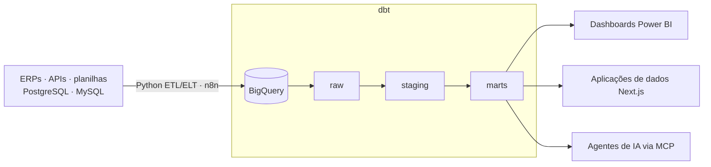

<h1>Eduardo Haas</h1>

**Senior Analytics Engineer · Engenheiro de Dados** — Santa Cruz do Sul, RS · aberto a remoto

Formado em Administração, virei engenheiro de dados. Construo plataformas de dados em produção de ponta a ponta — ingestão, modelagem em camadas com dbt, regras de negócio, BI e agentes de IA sobre a camada de dados — para 30+ empresas de 10+ segmentos, de hospitais a construtoras.

Autodidata: aprendi a maior parte da stack resolvendo problemas reais de clientes. Por isso me importo mais com a resposta certa do que com a solução mais sofisticada.

`8+ anos com dados em produção` · `150+ fontes integradas` · `200+ dashboards entregues` · `600+ usuários de negócio`

---

### Como eu construo plataformas de dados

- **Modelagem e regras de negócio** — DRE gerencial de hospital, rateio de custos entre empresas, camadas de indicadores em que o financeiro confia.
- **Aplicações de dados** — 15+ apps sob medida (Next.js, Supabase) em que a operação alimenta o warehouse direto: abastecimento de frota, integração com WhatsApp, portais de indicadores.
- **IA sobre a camada de dados** — agentes que montam propostas comerciais e um servidor MCP que conecta o Claude à operação da empresa.

### Stack

### Projetos

- [**management-pnl-dbt**](https://github.com/eduardohaas/management-pnl-dbt) — DRE gerencial de um grupo de empresas: rateio do centro de serviços compartilhados, resultado corrigido pelo IPCA (API do Banco Central), camadas dbt, unit tests e CI com documentação publicada.
- [**fleet-fuel-analytics-dbt**](https://github.com/eduardohaas/fleet-fuel-analytics-dbt) — Custo de combustível de uma frota contra os preços reais da ANP (107 mil preços de postos, atualizados toda semana): custo por km, pagamento acima do mercado e cinco regras de anomalia, com modelos incrementais.

Os projetos usam dados públicos reais (Banco Central, ANP) e dados de empresa fictícios. O trabalho do dia a dia fica em repositórios privados de clientes.

### Certificações

- **Anthropic Academy** — Building with the Claude API · Claude Code in Action · Model Context Protocol · Agent Skills (2026)
- **Data Science Academy** — Data Warehouses · Data Lake · Big Data Analytics · ML e IA em Ambientes Distribuídos (2023–24)

### Contato

[LinkedIn](https://www.linkedin.com/in/eduardo-haas-ab784b127/) · [eduardo@datenconsultoria.com.br](mailto:eduardo@datenconsultoria.com.br) · Português (nativo) · Inglês (B2)

<b>English</b>

 

**Senior Analytics Engineer · Data Engineer** based in southern Brazil, open to remote. Business Administration graduate turned data engineer: I build production data platforms end to end — ingestion, layered dbt modeling, business rules, BI and AI agents on the data layer — for 30+ companies across 10+ industries. Mostly self-taught, by solving real client problems.

Projects: [management-pnl-dbt](https://github.com/eduardohaas/management-pnl-dbt) (management P&L with shared-cost allocation and inflation-adjusted results) and [fleet-fuel-analytics-dbt](https://github.com/eduardohaas/fleet-fuel-analytics-dbt) (fleet fuel cost against real ANP retail prices, with anomaly rules). Both READMEs are in English.

