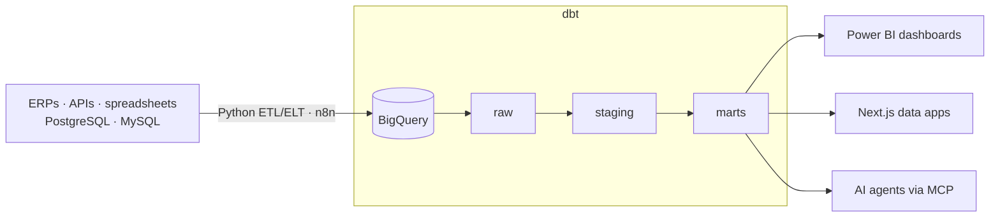

<h1>Eduardo Haas</h1>

**Senior Analytics Engineer · Data Engineer** — Santa Cruz do Sul, Brazil · open to remote

Business Administration graduate turned data engineer. I build production data platforms end to end — ingestion, layered modeling with dbt, business rules, BI and AI agents that sit on top of the data layer — for 30+ companies across 10+ industries, from hospitals to construction firms.

Mostly self-taught: I learned most of my stack by solving real client problems, which is why I care more about the right answer than the fanciest one.

`8+ years with production data` · `150+ data sources integrated` · `200+ dashboards shipped` · `600+ business users`

---

### How I build data platforms

- **Modeling & business rules** — management P&L for a hospital, multi-company cost allocation, KPI layers that finance teams actually trust.
- **Data apps** — 15+ custom apps (Next.js, Supabase) where operations feed the warehouse directly: fleet logs, WhatsApp integrations, KPI portals.
- **AI on the data layer** — agents that draft commercial proposals and an MCP server that lets Claude query and act on company operations.

### Stack

### Projects

- [**management-pnl-dbt**](https://github.com/eduardohaas/management-pnl-dbt) — Management P&L for a group of companies: shared-cost allocation, inflation-adjusted results (Central Bank API), dbt layers, unit tests and CI with live docs.
- [**HTML_For_PowerBI**](https://github.com/eduardohaas/HTML_For_PowerBI) — HTML & CSS snippets to build custom visuals inside Power BI through DAX measures.

Most of my day-to-day work lives in private client repositories.

### Certifications

- **Anthropic Academy** — Building with the Claude API · Claude Code in Action · Model Context Protocol · Agent Skills (2026)
- **Data Science Academy** — Data Warehouse Design · Data Lake Design & Integration · Big Data Analytics · ML & AI in Distributed Environments (2023–24)

### Get in touch

[LinkedIn](https://www.linkedin.com/in/eduardo-haas-ab784b127/) · [eduardo@datenconsultoria.com.br](mailto:eduardo@datenconsultoria.com.br) · Portuguese (native) · English (B2)
